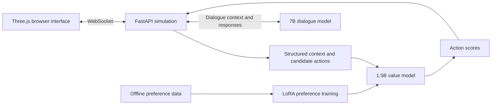

# Prison Demo: Small Language Models for NPC Agents

A multi-NPC simulation exploring how a learned value function and a language model can work together to produce decisions and dialogue in an interactive 3D environment.

**Project by Xintong Zhou.** This page presents the project architecture and my contributions. This public release includes the simulation, frontend assets, and model-pipeline code. Internal deployment notes, credentials, original training data, and model weights are excluded.

## Overview

Each NPC acts within a shared simulated world. A compact value model scores candidate actions from the current context, while a separate language model generates dialogue and internal monologues. The simulation maintains the world state and applies action constraints, and a browser interface makes the resulting behavior visible.

The project connects three parts of an agent system:

1. **Learning what to prefer:** train a value model from comparisons between candidate actions.
2. **Acting in an environment:** use model scores within the simulation's decision process.
3. **Speaking consistently:** condition dialogue on relevant world and character state.

## Architecture



### Action-value model

- **Base model:** Qwen2.5-1.5B-Instruct.
- **Adaptation:** LoRA and a trainable scalar scoring head.
- **Objective:** confidence-weighted Bradley–Terry preference loss, rewarding a preferred action with a higher score than its alternative.
- **Data split:** group preference pairs by scenario identifier before separating training and validation data, reducing leakage between comparisons derived from the same scenario.
- **Integration:** convert value-model outputs into scores used alongside the simulation's other decision factors and constraints.

### Dialogue model

- **Base model:** Qwen2.5-7B with QLoRA/SFT adaptation.
- **Serving:** local dialogue inference through Ollama.
- **Interaction:** dialogue, inner monologues, and player-facing conversations are grounded in character and world context.

### Simulation and interface

- FastAPI backend with a persistent simulation loop and WebSocket updates.
- World and character state, candidate actions, navigation, social interactions, and gameplay events.
- Three.js browser interface for inspecting the environment and following NPC decisions.
- Separate services for action scoring and language generation.

## My contributions

I worked across the model pipeline and the interactive demo:

- Prepared scenarios and preference data and implemented LoRA-based value-model training.
- Connected model inference to the simulation's action-selection process.
- Developed and integrated simulation behavior, shared context, and the backend–frontend interaction.
- Worked on dialogue adaptation and local model deployment.
- Built evaluation and diagnostic scripts for pairwise preferences, behavioral ordering, and service integration.

## Evaluation approach

The implementation includes held-out pairwise preference evaluation, checks for behavioral ordering and monotonicity, and probes for model-serving and simulation integration. These measure different properties: matching preference labels does not by itself establish reliable behavior throughout a running simulation.

This overview intentionally does not report a single aggregate “agent reliability” score. Reproducing a training result requires the corresponding data version, split, model checkpoint, and evaluation configuration; those artifacts are not part of this public page.

## What I learned

- Keep the context representation consistent between training and inference.
- Separate learned preferences from explicit environment constraints.
- Evaluate both isolated model decisions and their effect within the running system.
- Treat dialogue and action as parts of one stateful interaction.

## Run the simulation without model weights

Use Python 3.11 or later. From the repository root:

```bash
python -m venv .venv
source .venv/bin/activate
python -m pip install -r backend/requirements.txt
```

Open three terminals, activate the same environment in each, and run:

```bash
# Terminal 1: heuristic action-scoring service
python -m uvicorn mock_value_server:app --app-dir backend --host 127.0.0.1 --port 8010

# Terminal 2: simulation backend (macOS/Linux environment-variable syntax)
MODEL_URL=http://127.0.0.1:8010/score python -m uvicorn app.main:app --app-dir backend --host 127.0.0.1 --port 8000

# Terminal 3: browser frontend
python -m http.server 5173 --bind 127.0.0.1 --directory frontend
```

Open **http://127.0.0.1:5173**. The health endpoint is **http://127.0.0.1:8000/health**.

On Windows PowerShell, activate with `.\.venv\Scripts\Activate.ps1` and set the backend variable on its own line: `$env:MODEL_URL = "http://127.0.0.1:8010/score"`.

This mode uses a **heuristic mock**, so it demonstrates the simulation and interface rather than learned model quality. The mock implements a legacy batch schema; the model client falls back to individual scoring requests. Dialogue features require a separately configured local language model. The browser frontend loads Three.js from a CDN and therefore needs access to that CDN.

## Run with learned models

See [the model pipeline](value-model/README.md) for scenario generation, teacher annotation, preference training, merging, and evaluation.

- Start `value-model/value_server.py` with a compatible merged value-model checkpoint; the default scoring endpoint is port 8009.
- Configure a local Ollama dialogue model using `LOCAL_LLM_URL` and `LOCAL_LLM_MODEL`.
- The original tag `prison-convo:q4` refers to a project-specific fine-tuned model and is not distributed here. Using a base-model substitute changes the behavior.
- No teacher API is needed for the local mock mode. Teacher annotation is an optional offline step requiring your own provider and credentials.

## Repository layout

```text
backend/app/       Simulation, character/world state, model clients, and WebSocket API
backend/           Mock scoring service and integration probes
frontend/src/      Three.js interface
frontend/assets/   Scene and character assets included with author authorization
frontend/tools/    Generic GLB inspection and preparation utilities
value-model/       Scenario generation, preference learning, SFT, evaluation, and serving
```

## Public release scope

Source code and art assets are included with the author's confirmation that they may be published. Internal gateway addresses, deployment scripts, private working notes, raw training data, model weights, and local run outputs have been excluded. The source snapshot is provided for inspection and experimentation; the original GPU training results have not been reproduced as part of this release cleanup.

For research enquiries: [xzhoucp@connect.ust.hk](mailto:xzhoucp@connect.ust.hk).
