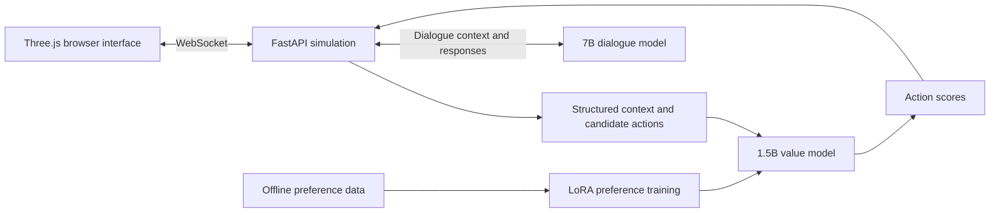

# Prison Demo: Small Language Models for NPC Agents

A multi-NPC simulation exploring how a learned value function and a language model can work together to produce decisions and dialogue in an interactive 3D environment.

**Project by Xintong Zhou.** This page presents the project architecture and my contributions. The original implementation includes internship-specific dependencies and assets; this public overview does not include those materials or model weights.

## Overview

Each NPC acts within a shared simulated world. A compact value model scores candidate actions from the current context, while a separate language model generates dialogue and internal monologues. The simulation maintains the world state and applies action constraints, and a browser interface makes the resulting behavior visible.

The project connects three parts of an agent system:

1. **Learning what to prefer:** train a value model from comparisons between candidate actions.
2. **Acting in an environment:** use model scores within the simulation's decision process.
3. **Speaking consistently:** condition dialogue on relevant world and character state.

## Architecture

### Action-value model

- **Base model:** Qwen2.5-1.5B-Instruct.
- **Adaptation:** LoRA and a trainable scalar scoring head.
- **Objective:** confidence-weighted Bradley–Terry preference loss, rewarding a preferred action with a higher score than its alternative.
- **Data split:** group preference pairs by scenario identifier before separating training and validation data, reducing leakage between comparisons derived from the same scenario.
- **Integration:** convert value-model outputs into scores used alongside the simulation's other decision factors and constraints.

### Dialogue model

- **Base model:** Qwen2.5-7B with QLoRA/SFT adaptation.
- **Serving:** local dialogue inference through Ollama.
- **Interaction:** dialogue, inner monologues, and player-facing conversations are grounded in character and world context.

### Simulation and interface

- FastAPI backend with a persistent simulation loop and WebSocket updates.
- World and character state, candidate actions, navigation, social interactions, and gameplay events.
- Three.js browser interface for inspecting the environment and following NPC decisions.
- Separate services for action scoring and language generation.

## My contributions

I worked across the model pipeline and the interactive demo:

- Prepared scenarios and preference data and implemented LoRA-based value-model training.
- Connected model inference to the simulation's action-selection process.
- Developed and integrated simulation behavior, shared context, and the backend–frontend interaction.
- Worked on dialogue adaptation and local model deployment.
- Built evaluation and diagnostic scripts for pairwise preferences, behavioral ordering, and service integration.

## Evaluation approach

The implementation includes held-out pairwise preference evaluation, checks for behavioral ordering and monotonicity, and probes for model-serving and simulation integration. These measure different properties: matching preference labels does not by itself establish reliable behavior throughout a running simulation.

This overview intentionally does not report a single aggregate “agent reliability” score. Reproducing a training result requires the corresponding data version, split, model checkpoint, and evaluation configuration; those artifacts are not part of this public page.

## What I learned

- Keep the context representation consistent between training and inference.
- Separate learned preferences from explicit environment constraints.
- Evaluate both isolated model decisions and their effect within the running system.
- Treat dialogue and action as parts of one stateful interaction.

## Availability

This repository currently serves as a **project showcase**. It does not provide a runnable public release. Internship infrastructure, training data, model weights, and third-party game assets are excluded.

For research enquiries: [xzhoucp@connect.ust.hk](mailto:xzhoucp@connect.ust.hk).
